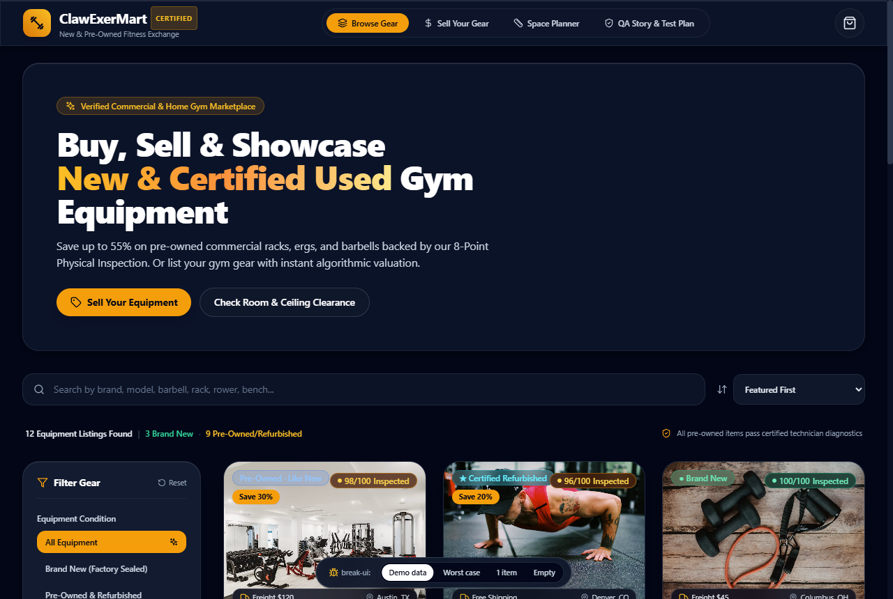
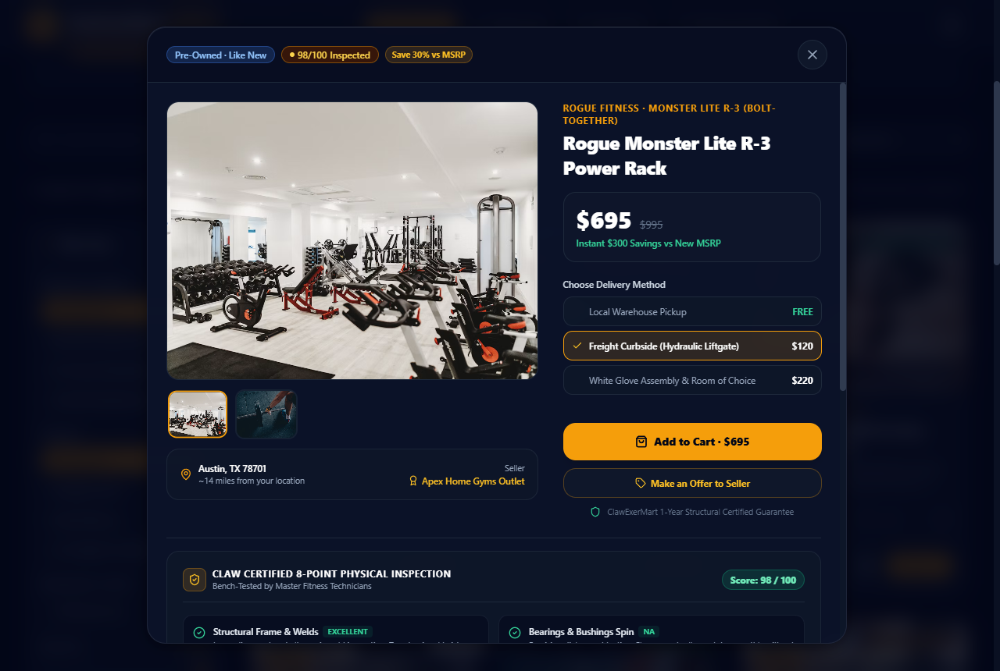
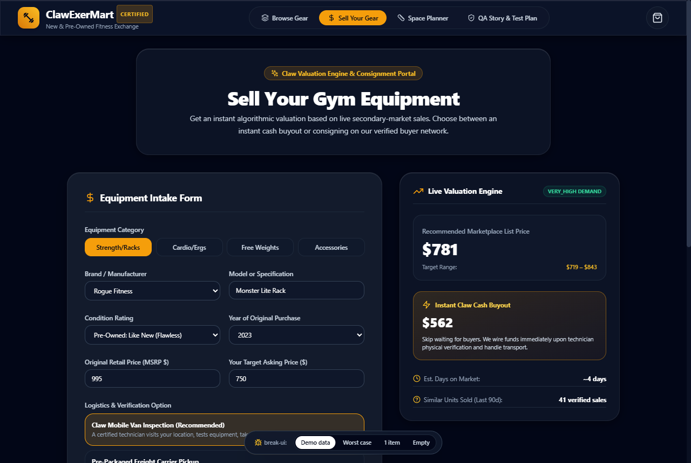
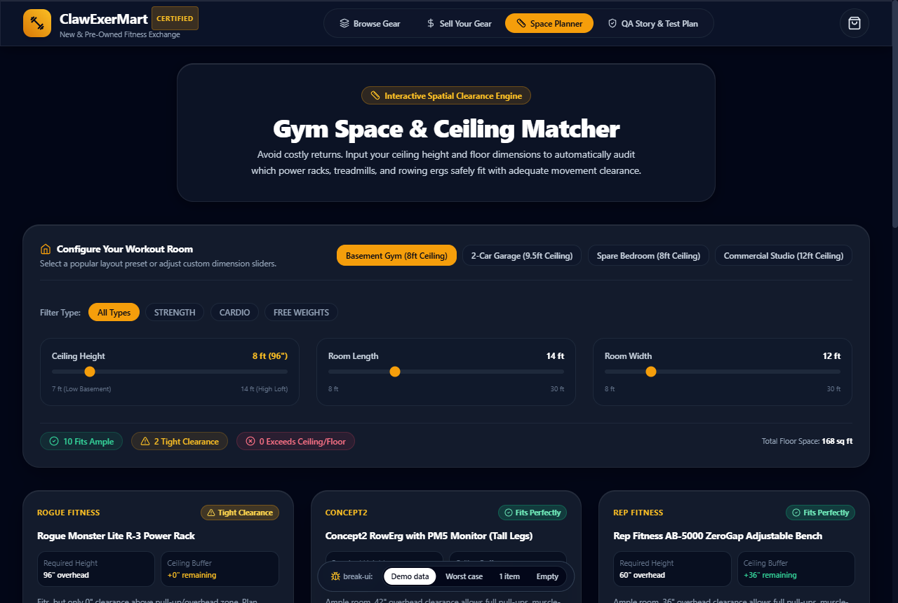
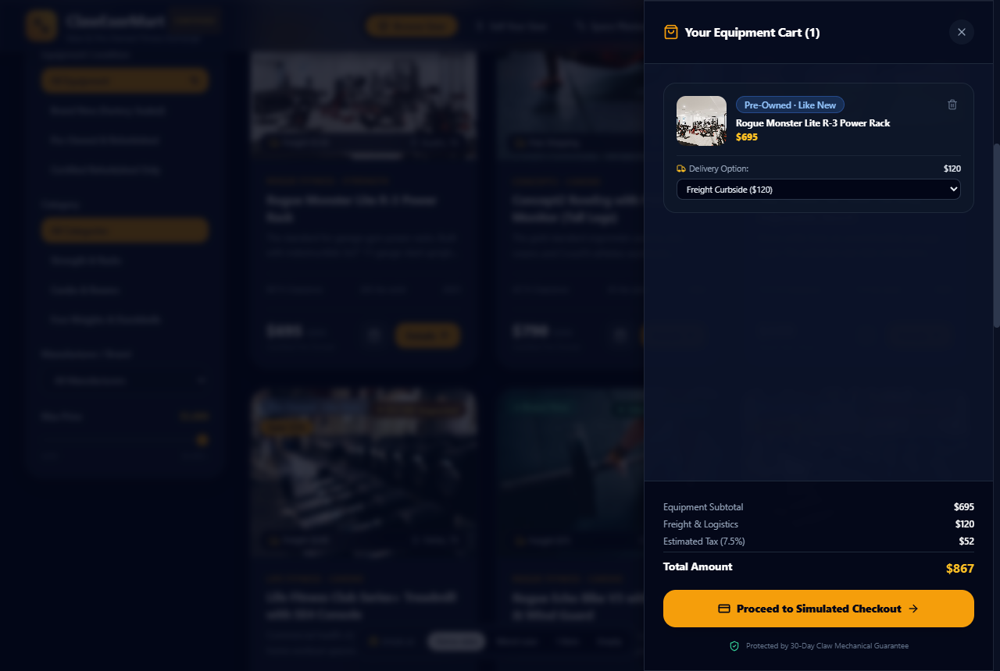

# ClawExerMart

Pre-owned and new fitness equipment marketplace built with the [SeikoClaw Harness](https://github.com/Saikojin/SeikoClaw-Harness).

Built with React 18, Vite 5, TypeScript, and Tailwind CSS with zero PHP dependencies.

---

## With vs. without SeikoClaw Harness

ClawExerMart is the harness-driven counterpart to [RawExerMart](https://github.com/Saikojin/RawExerMart), which was generated from the same base prompt (a new and used gym equipment marketplace using Michael Leonard's [Story Test Plan Template](https://medium.com/@michael.leonard/story-test-plan-template-a4202531e741)) without SeikoClaw skills or gates.

| Dimension | [RawExerMart](https://github.com/Saikojin/RawExerMart) (No Harness) | ClawExerMart (With SeikoClaw Harness) | SeikoClaw Skill / Gate Applied |
| :--- | :--- | :--- | :--- |
| **Domain modeling** | Generic catalog grid + static vendor price comparison table | 8-point physical technician inspection sheet, room & ceiling height clearance matcher, algorithmic resale/buyout valuation, counter-offer negotiation, and freight liftgate tiers | `codebase-design` |
| **UI & motion physics** | Default Tailwind styles; stock `animate-bounce` toast | Optical typography (`-0.025em`), tactile pointer scaling (`scale(0.97)` at `120ms`), layered `backdrop-filter: blur(20px)` glass, GPU-only sub-300ms transitions, `prefers-reduced-motion` guard | `apple-design`, `animate`, `review-animations` |
| **Adversarial UI stress testing** | Built only against short, clean demo strings | Live `break-ui` switcher (`Demo data / Worst case / 1 item / Empty`) testing 145-char titles, `$129,999` prices, CJK/diacritics, broken image URLs, and 52-char serial hashes | `break-ui` |
| **Browser verification** | JSDOM-only tests; never opened a real browser | Non-headless windowed Chrome execution (`scripts/run-e2e.mjs`) with 0 console errors and 7 committed visual proof captures in `captures/` | `seikojin-qa` (`[E2E_CONTRACT]`) |
| **Code & smell audit** | Unreviewed single-pass implementation | Two-axis Standards (Fowler smell baseline) and Spec review documented in `docs/WORKFLOW_LOG.md` | `code-review`, `deslop` |

---

## Visual verification captures (`seikojin-qa`)

Every screen below is captured automatically by `node scripts/run-e2e.mjs` running in visible non-headless Chrome against the production Vite preview build.

### 1. Hero & frosted glass navigation (`captures/R1_navbar.png`)


### 2. Marketplace catalog & stacked condition badges (`captures/R2_catalog.png`)


### 3. Certified 8-point physical inspection modal (`captures/R3_product_modal.png`)


### 4. Algorithmic resale & instant cash buyout portal (`captures/R4_sell_portal.png`)


### 5. Gym room & ceiling clearance matcher (`captures/R5_space_matcher.png`)


### 6. LTL freight & liftgate checkout drawer (`captures/R6_cart_checkout.png`)


### 7. Adversarial `break-ui` worst-case stress mode (`captures/R7_break_ui_stress.png`)


---

## Adversarial UI stress audit (`break-ui`)

Use the bottom-center `break-ui` bar (or visit `?data=worst`, `?data=single`, `?data=empty`) to flip between datasets in real time. Running the `break-ui` workflow uncovered and fixed 8 layout and logic defects that were invisible under clean demo data:

| # | Severity | Component & Field | Worst-case input | What broke before fix | Fix applied |
| :--- | :--- | :--- | :--- | :--- | :--- |
| 1 | **Broken** | `Catalog.tsx` (`maxPrice` filter) | `$24,995` & `$129,999` commercial gym lots | Slider max was `5000` (`$5,000+`), silently hiding every item priced over `$5,000` on initial load | Treated `maxPrice === 5000` as unbounded (`$5,000+`) in `Catalog.tsx:73` |
| 2 | **Ugly** | `EquipmentCard.tsx` (`badge-savings`) | Pre-owned item with `Save 30%` pill | Top-left `flex-wrap` row stretched horizontally into the top-right `98/100 Inspected` badge | Stacked top-left badges vertically with `flex-col items-start gap-1.5 max-w-[58%]` in `EquipmentCard.tsx:53` |
| 3 | **Broken** | `EquipmentCard.tsx` & `ProductDetailModal.tsx` (`images[0]`) | Broken URL `https://invalid.example.test/...` | Browser rendered broken image icon with collapsed container contrast | Added `imgError` state and fallback surface (`Verified Equipment Photo Pending`) in `EquipmentCard.tsx:41` |
| 4 | **Ugly** | `EquipmentCard.tsx` (`location.city`) | `Kleinfeltersville-Schwenksville, PA` | Long compound city name wrapped the bottom image overlay onto two lines | Added `min-w-0 truncate` on location and `flex-shrink-0` on freight cost in `EquipmentCard.tsx:76` |
| 5 | **Ugly** | `EquipmentCard.tsx` (`brand`) | `Hammer Strength by Life Fitness Commercial Division` | Brand header wrapped onto 2 lines, misaligning card titles across the 3-column grid | Added `truncate` and `title` tooltip in `EquipmentCard.tsx:88` |
| 6 | **Ugly** | `EquipmentCard.tsx` (`price` + `originalMsrp`) | `$129,999` with `$185,000` strikethrough MSRP | Six-figure price + MSRP compressed the `Add to Cart` and `Details` buttons | Added `tabular-nums`, `min-w-0` on price column, and `flex-shrink-0` on CTA group in `EquipmentCard.tsx:113` |
| 7 | **Ugly** | `Catalog.tsx` (`filteredItems.length`) | `1 item` dataset mode | Rendered `"1 Equipment Listings Found"` | Added singular/plural check (`1 Equipment Listing Found`) in `Catalog.tsx:175` |
| 8 | **Ugly** | `ProductDetailModal.tsx` (`seller.name` & `specs`) | `Aleksandra Wiśniewska-Kowalczyk...` & 52-char serial hash | Long seller name collided with location; unbreakable spec token overflowed right column | Added `min-w-0 truncate` on seller name and `break-all sm:break-words` on spec values in `ProductDetailModal.tsx:128,325` |

---

## Motion & animation audit (`review-animations`)

| Before | After | Why |
| :--- | :--- | :--- |
| `transform: scale(0)` on modal opening | `transform: scale(0.98)` + `opacity: 0` entering to `scale(1)` | Scaling from `0.98` maintains physical presence without jarring pop-in |
| Built-in CSS easings | Custom ease-out curve `cubic-bezier(0.16, 1, 0.3, 1)` | Snaps into rest cleanly within a sub-300ms budget (`120ms` press, `220ms` modal, `260ms` drawer) |
| Layout property transitions | GPU-accelerated `transform` and `opacity` only | Prevents layout reflow on drawer slide and card hover |
| Unmitigated motion for vestibular sensitivity | `@media (prefers-reduced-motion: reduce)` in `src/index.css` | Resets animation and transition durations to `0.01ms` |

---

## Quality engineering & 4-tier test pyramid

Modeled after Michael Leonard's Story Test Plan framework:

1. **Tier 1: Unit tests** (`src/test/domainUtils.test.ts`, `src/test/mockData.test.ts`). Pure valuation algorithms, condition discount factors, and spatial clearance math.
2. **Tier 2: Component & adversarial tests** (`src/test/*.test.tsx`, `src/test/BreakUi.test.tsx`). 23 tests across 9 suites covering catalog filtering, modal transitions, offer submissions, sell forms, cart calculations, and `break-ui` worst-case datasets.
3. **Tier 3: Non-headless E2E tests** (`scripts/run-e2e.mjs`). Complete Rabbit Path and `break-ui` stress mode verified in visible windowed Chrome with 7 screenshots saved to `captures/`.
4. **Tier 4: Visual & motion critic** (`docs/STORY_TEST_PLAN.md`, `docs/WORKFLOW_LOG.md`).

---

## Getting started

```bash
git clone https://github.com/Saikojin/ClawExerMart.git
cd ClawExerMart
npm install
```

### Run development server
```bash
npm run dev
```

### Run automated unit, component & `break-ui` tests
```bash
npm test
```

### Run production build & non-headless Chrome E2E suite
```bash
npm run build
node scripts/run-e2e.mjs
```
